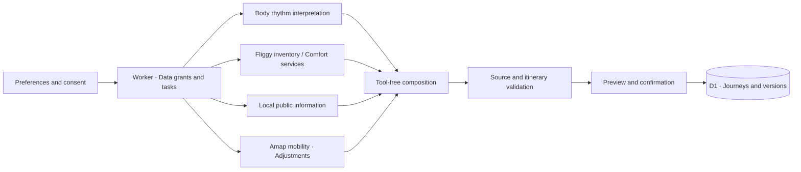

<div align="center">


# BioTrip · Travel at your own rhythm

**Real places. Flexible plans. A little room to breathe.**

[Try BioTrip](https://biotrip.ccwu.cc) · [简体中文](README.md) · [Integrations](docs/platform-access-checklist.md) · [Privacy](https://biotrip.ccwu.cc/privacy)

[](docs/cloudflare-deployment.md)
[](package.json)
[](tsconfig.json)
[](docs/bailian-agent-setup.md)
[](docs/amap-mobility-setup.md)
[](#verification-and-release)
[](.github/workflows/ci.yml)

</div>

## Plan before departure. Adjust along the way.

BioTrip is a mobile-first travel planning app built for the Fliggy hackathon. It turns travel preferences, current self-reports, time-zone changes and optional WHOOP signals into itinerary suggestions backed by real sources.

Tired legs? Change a transfer. Need quiet? Make room for a break. Suggestions remain proposals until you select and apply them. Fixed appointments are protected, and previous itinerary versions can be restored.

<table>
<tr>
<td width="50%"><strong>🧭 Start with real sources</strong><br />Fliggy products and local public information are shown separately. Product images and links come from verified retrieval results.</td>
<td width="50%"><strong>🌿 Follow today's rhythm</strong><br />Preferences and self-reports work on their own. WHOOP is optional and requires separate consent for each use.</td>
</tr>
<tr>
<td><strong>🚕 Walk a little less</strong><br />An independent Amap adviser checks routes between adjacent places, showing returned travel times, distances and optional fares.</td>
<td><strong>📖 Keep your choices</strong><br />Background tasks expose progress, drafts follow your account, and selected adjustments are saved as restorable versions.</td>
</tr>
</table>

## A journey in four steps

1. **Choose a destination and dates**, then set your travel pace and preferences.
2. **Confirm how your data will be used**, generate a plan and inspect its sources.
3. **Share how you feel during the trip**. Local rules provide initial suggestions while advisers gather evidence in parallel.
4. **Select the changes you want**, preview them and save a new version while retaining fixed appointments and the original plan.

Generation failures report their actual cause rather than returning sample itineraries as real results. If adjustment advisers are unavailable, clearly labelled rule-based suggestions remain usable. BioTrip provides recommendations and source links; booking, payment and changes to third-party orders remain the user's responsibility.

## Advisers with clear boundaries



| Adviser | Inputs and responsibility | Boundary |
| :--- | :--- | :--- |
| Body rhythm | Self-reports and WHOOP records explicitly permitted for this run | No tools, Skills, MCP or travel Vault |
| Fliggy inventory / Comfort services | Travel search parameters and real product sources | Travel credentials are attached only to controlled inventory sessions |
| Local information | City and permitted travel preferences or other search parameters | Public information stays separate from Fliggy products |
| Amap mobility | City and names of adjacent public places | Independent Agent; five read-only tools; no current GPS access |
| Composition | Abstract body rhythm, verified sources and permitted memory | Tool-free session; no repeated search or raw WHOOP records |

`DataGrant` restricts stage inputs. Restricted Agents' actual Session configuration is checked before data is sent. Amap figures are extracted from paired raw tool events; model summaries cannot serve as route evidence. See [Bailian setup](docs/bailian-agent-setup.md) and [Amap setup](docs/amap-mobility-setup.md).

## Run locally

Requires **Node.js 22+**, **pnpm 10**, and Bailian / FlyAI credentials for real planning.

```bash
pnpm install --frozen-lockfile
cp .env.example .dev.vars
# Fill in local configuration and credentials following the setup guides
pnpm exec wrangler d1 migrations apply biotrip-users --local
pnpm dev:vinext
```

Open [localhost:3001](http://localhost:3001). Production uses **vinext + Cloudflare Workers**. Next.js development scripts remain available; use the path above when verifying Worker bindings and background tasks.

| Integration | Configuration |
| :--- | :--- |
| Bailian | Standard API key, workspace, Agent and environment IDs; [setup](docs/bailian-agent-setup.md) |
| FlyAI | Official API key, signing configuration and controlled travel Vault; [integrations](docs/platform-access-checklist.md) |
| Amap | Web Service key stored only in Bailian's private official MCP configuration; separate Agent / environment IDs in the app |
| Email sign-in | Account encryption settings and Resend; [email setup](docs/email-auth-setup.md) |
| WHOOP (optional) | Dedicated Developer App, exact callback URL and server-side encryption secrets |

Use Worker Secrets in production. `.dev.vars`, `.env.local`, local databases and verification output are excluded from Git. Keep secrets out of frontend code, screenshots, command arguments and chat.

## Verification and release

As of **2026-10-05**:

- **351 local tests passed**, along with TypeScript, targeted ESLint and a vinext production build. The badge records local verification; see [Actions](https://github.com/EazyLee30/biotrip-fliggy-hackathon/actions) for GitHub CI results.
- **Real Amap flow verified locally**: Session configuration → raw SSE → suggestion card → individual acceptance → D1 version persistence. One West Lake → Lingyin Temple query returned approximately 28 minutes by car and 5.5 km. This was a time-specific estimate and changes with traffic.
- **Deployed** to [biotrip.ccwu.cc](https://biotrip.ccwu.cc), version `c0d6d885-ca1f-40cb-8084-a3930ef86553`. Production migrations are current, pages and assets load, and anonymous task endpoints require authentication.
- **Still to verify**: a real route consultation in production and physical-phone testing. The WHOOP app remains in Sandbox; available slots depend on the platform.

See [deployment history](docs/cloudflare-deployment.md), [adjustment work log](docs/adjustment-continuation.md) and [mobile acceptance](docs/mobile-acceptance.md) for verification scope. Detailed engineering documents are currently in Chinese.

## Repository map

```text
src/app/                    Pages, APIs and mobile-first interaction
src/lib/planning/           Data grants, advisers, evidence and tasks
src/lib/adjust/             Rules, conflict checks and itinerary reflow
src/workers/                Worker entry and persistent Workflow
migrations/                 D1 database migrations
public/                     Fonts, ambience and destination assets
bailian/                    FlyAI Skill and integration materials
```

[Project status](docs/project-plan.md) · [Product work log](docs/zen-product-execution.md) · [Visual credits](https://biotrip.ccwu.cc/credits) · [Competition and data boundaries](docs/competition-rules-and-data.md)

## Data and assets

WHOOP tokens are encrypted per account; raw body metrics are not stored in the database. The Worker learns preferences from the user's own choices. Public sharing requires separate confirmation, excludes dates, full itineraries, health data and personal memory, and can be revoked. See the [privacy policy](https://biotrip.ccwu.cc/privacy) for the complete rules.

Generated ambience and destination photography are labelled separately. Photo, font and third-party Skill licenses are recorded alongside their assets. No repository-wide open-source license has been declared.

<div align="center">

**Let your journey take care of you, today.**

[Try BioTrip ↗](https://biotrip.ccwu.cc)

</div>
