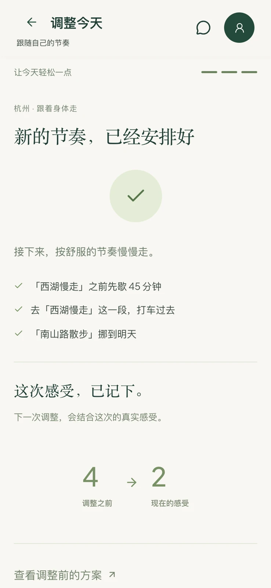
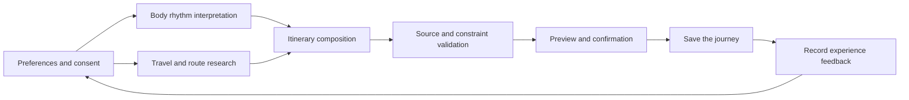

<p align="center">
  <a href="https://biotrip.eazylee.si">
    
  </a>
</p>

<p align="center"><strong>An AI travel companion that listens to how you feel.</strong></p>

<p align="center">
  <a href="https://biotrip.eazylee.si/app"><strong>Start a journey ↗</strong></a> &nbsp; · &nbsp;
  <a href="https://biotrip.eazylee.si/#film">Watch the film · 02:37</a> &nbsp; · &nbsp;
  <a href="https://biotrip.eazylee.si">Website</a> &nbsp; · &nbsp;
  <a href="README.md">简体中文</a>
</p>

<p align="center">
  <a href="https://github.com/EazyLee30/biotrip-fliggy-hackathon/actions/workflows/ci.yml"></a>
  <a href="docs/verification.md"></a>
  
</p>

<br />

## Your plans should listen to you, too

A short night of sleep. Tired legs by afternoon. A teahouse worth staying in a little longer. How you feel changes throughout a journey. Your plans should have room to change with you.

BioTrip brings travel preferences, current self-reports and authorized WHOOP records into planning. Walk less, make time for a break or adjust the pace. Preview each change before accepting it, with fixed appointments and completed activities protected.

## From how you feel to a better next step

<p align="center">
   &nbsp;
   &nbsp;
  
</p>

<p align="center"><sub>Your day &nbsp; / &nbsp; Body records &nbsp; / &nbsp; Changes and feedback</sub></p>

| 01 · Check in | 02 · Adjust | 03 · Reflect | 04 · Refine |
| :--- | :--- | :--- | :--- |
| Record how you feel | Preview and accept changes | Tell BioTrip how it felt | Let recent feedback inform the next suggestion |

Recent feedback within a journey shapes subsequent suggestions. One tired afternoon stays a moment in time; long-term preferences are saved at your choice.

WHOOP recovery, sleep, strain and steps are supported. Self-reports let you use the core experience without a device. **Support for additional wearable data sources is planned.**

<sub>Actual product interfaces. WHOOP readings are authorized historical records. The Hangzhou journey and subjective fatigue changes illustrate a demonstration scenario.</sub>

## With you along the way

| Capability | How it helps |
| :--- | :--- |
| **A plan of your own** | Daily itineraries based on your destination, dates and preferences, with manual editing and version history. |
| **Discoveries with sources** | Fliggy travel services, local information and Amap routes retain their provenance. Unverified information is not presented as fact. |
| **A companion to talk to** | Look up plans, manage lists and propose adjustments. Itinerary changes need your confirmation. |
| **A pace it can remember** | Manage daily, journey and long-term memories. Edit, disable or undo saved preferences. |
| **Moments worth keeping** | Collect places and share a travel journal with control over what becomes public. |

[See a journey shaped around how you feel — watch the 02:37 film →](https://biotrip.eazylee.si/#film)

## Built for real journeys

**React 19 · TypeScript · Next.js / vinext · Cloudflare Workers · D1 · Workflows**

Alibaba Cloud Bailian powers planning and conversation. FlyAI retrieves travel services, Amap checks routes, and WHOOP supplies optional body records. The server enforces consent, source validation, itinerary constraints and version checks.

<details>
<summary><strong>Explore the architecture and data boundaries</strong></summary>



- Raw body records enter a dedicated interpretation stage. Travel searches use public travel conditions.
- Inventory, local research, route checks and composition have separate responsibilities and permissions.
- Missing prices, route figures and links stay unknown. Empty search results are reported clearly.
- Itinerary changes require confirmation and another server-side ownership, version and constraint check.

See [architecture](docs/architecture.md).

</details>

## Run locally

Requires **Node.js 22+** and **pnpm 10**. Real planning needs Bailian and FlyAI configuration; email sign-in requires an email provider. WHOOP is optional.

```bash
pnpm install --frozen-lockfile
cp .env.example .dev.vars
# Fill in local variables following the integration guides
pnpm exec wrangler d1 migrations apply biotrip-users --local
pnpm dev:vinext
```

Open [localhost:3001](http://localhost:3001), then `/app`. For your own deployment, replace the domain, database and service identifiers in `wrangler.jsonc` with your configuration.

| Guide | Contents |
| :--- | :--- |
| [Integrations](docs/platform-access-checklist.md) | Bailian, FlyAI, WHOOP and account configuration |
| [Deployment](docs/cloudflare-deployment.md) | Worker, D1 migrations and production configuration |
| [Bailian](docs/bailian-agent-setup.md) | Planning providers, Agents and permissions |
| [Amap](docs/amap-mobility-setup.md) | Independent route adviser and route evidence |
| [Email sign-in](docs/email-auth-setup.md) | Sending domains and login emails |
| [Verification](docs/verification.md) | Check commands, coverage and known limitations |

<details>
<summary><strong>Repository structure and verification commands</strong></summary>

```text
src/app/             Product pages, APIs and mobile interaction
src/lib/             Planning, assistant, feedback and source validation
src/workers/         Worker entry and background Workflow
migrations/          D1 database migrations
public/              Application assets, website and product film
bailian/             FlyAI Skill and configuration references
docs/                Setup guides, architecture and asset licenses
```

```bash
pnpm exec tsc --noEmit
pnpm test
pnpm lint
pnpm run build:vinext
```

As of October 23, 2026, all 486 tests and CI checks passed, as did 35 production checks for the website release. Browser mobile emulation and physical-device testing are recorded separately. See the verification guide for scope. Engineering documentation is in Chinese.

</details>

## Data and assets

WHOOP authorization records are encrypted per account. Public sharing excludes health data and personal memories. Production secrets remain on the server. Local credentials, databases, design drafts, development screenshots and video production projects are excluded from the repository.

[Privacy](https://biotrip.eazylee.si/privacy) · [Visual credits](https://biotrip.eazylee.si/credits) · [Asset licenses](docs/assets/README.md)

The source is public; no repository-wide open-source license has been declared. Third-party assets and Skills retain their respective licenses.

<br />

<p align="center">
  <br />
  <sub>Independently built by <a href="https://github.com/EazyLee30">Eazy Lee</a></sub><br /><br />
  <strong>The world is wide. Travel at your own rhythm.</strong><br />
  <a href="https://biotrip.eazylee.si/app">Set off with BioTrip ↗</a>
</p>
