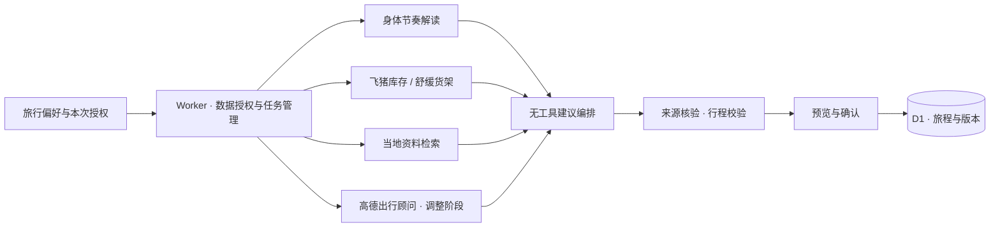

<div align="center">


# BioTrip · 让行程适合今天的你

**真实的目的地，灵活的安排，留一点空间给自己。**

[产品官网](https://biotrip.eazylee.si) · [在线体验](https://biotrip.eazylee.si/app) · [产品影片](https://biotrip.eazylee.si/#film) · [English](README.en.md) · [接入说明](docs/platform-access-checklist.md) · [隐私说明](https://biotrip.eazylee.si/privacy)

[](docs/cloudflare-deployment.md)
[](package.json)
[](tsconfig.json)
[](docs/bailian-agent-setup.md)
[](docs/amap-mobility-setup.md)
[](#验证与发布状态)
[](.github/workflows/ci.yml)

</div>

## 出发之前计划，旅途中调整

BioTrip 是由 Eazy Lee 独立构建的手机优先旅行规划应用。它将旅行偏好、当下自评、时区变化和可选的 WHOOP 身体信号，转化为有真实来源、可以逐条选择的行程建议。

腿脚累了，换一段交通；想安静，给自己加一点休息。调整先提出建议，由你决定采纳哪些，固定预约受到保护，原安排可以从版本历史恢复。

调整后再次记录感受，让同一旅程内的近期反馈参与后续建议，形成“记录感受 → 调整旅程 → 体验反馈 → 优化后续建议”的闭环。长期偏好由用户选择记住。身体数据看板已支持 WHOOP 的恢复、睡眠、活动负荷和步数；更多可穿戴设备的数据源将在后续接入。

[观看 2 分 37 秒产品影片](https://biotrip.eazylee.si/#film)。官网包含真实产品界面与经本人授权的 WHOOP 历史记录，影片中的主观疲劳变化为演示情境。

<table>
<tr>
<td width="50%"><strong>🧭 从真实来源开始</strong><br />飞猪旅行服务与当地公开资料分别展示，商品图片与链接来自核验后的检索结果。</td>
<td width="50%"><strong>🌿 跟随今天的状态</strong><br />偏好与自评即可使用；WHOOP 是可选输入，每次使用前单独确认。</td>
</tr>
<tr>
<td><strong>🚕 少走一段路</strong><br />高德独立出行顾问核验相邻地点的路线，展示实际返回的时长、距离和可选车费。</td>
<td><strong>📖 保留你的选择</strong><br />后台任务可持续读取进度，草稿随账号保存，调整逐条采纳，历史版本可恢复。</td>
</tr>
</table>

## 用对话安排，也能随时手动修改

底部「聊聊旅程」可打开对话抽屉并展开全屏，指定旅程后创建、调整或恢复安排；每项变更先预览再确认。长期偏好可从新对话自动提取，旅程约束和当天状态有独立范围与有效期，记忆可查看、编辑、停用或撤销。实现与验收状态见 [对话助手执行记录](docs/agent-execution.md)。

## 一段旅程如何发生

1. **选好目的地与日期**，告诉 BioTrip 你的旅行节奏和偏好。
2. **确认本次数据用途**，生成行程并查看真实商品与资料来源。
3. **旅行中反馈感受**，基础建议先就绪，顾问并行核验补充信息。
4. **选择想采纳的建议**，预览后保存新版本；保留固定安排与原版本。
5. **体验后再记录感受**，让近期反馈参与下一次建议。

生成失败会展示实际原因，不用示例行程冒充真实结果。调整顾问不可用时，仍可使用明确标注的基础建议。BioTrip 提供建议与来源链接，预订、付款和第三方订单修改由用户自行完成。

## 分工清楚的顾问



| 顾问 | 输入与职责 | 边界 |
| :--- | :--- | :--- |
| 身体节奏 | 自评，以及本次获准使用的 WHOOP 记录 | 无工具、Skill、MCP 或旅行 Vault |
| 飞猪库存 / 舒缓货架 | 旅行搜索参数、真实商品来源 | 旅行凭据只挂载到受控库存会话 |
| 当地资料 | 城市与获准的旅行偏好等检索参数 | 公开资料与飞猪商品分开展示 |
| 高德出行 | 城市与相邻公开地点名 | 独立 Agent；只启用五个只读工具，不获取当前 GPS |
| 建议编排 | 抽象身体节奏、核验后的来源与获准记忆 | 无工具会话；不重复搜索，不接收 WHOOP 原始记录 |

代码通过 `DataGrant` 限制阶段输入，并在投递前核对受限 Agent 的实际 Session 配置。高德数字从配对的原始工具事件提取，模型总结不能充当路线事实。详情见 [百炼接入](docs/bailian-agent-setup.md) 与 [高德接入](docs/amap-mobility-setup.md)。

## 本地启动

需要 **Node.js 22+**、**pnpm 10**，以及用于真实规划的百炼与 FlyAI 配置。

```bash
pnpm install --frozen-lockfile
cp .env.example .dev.vars
# 按配置文档填写 .dev.vars 中的本地环境变量与密钥
pnpm exec wrangler d1 migrations apply biotrip-users --local
pnpm dev:vinext
```

打开 [localhost:3001](http://localhost:3001)。当前生产路径使用 **vinext + Cloudflare Workers**；项目保留 Next.js 开发脚本，Worker 绑定与后台任务请用上述路径验收。

| 配置 | 说明 |
| :--- | :--- |
| 百炼 | 标准 API Key、工作空间、各 Agent 与运行环境，见 [配置指南](docs/bailian-agent-setup.md) |
| FlyAI | 官方 API Key、签名配置与受控旅行 Vault，见 [平台接入](docs/platform-access-checklist.md) |
| 高德 | Web 服务 Key 只保存在百炼官方 MCP 私密配置，应用配置独立 Agent / 环境 ID |
| 登录邮件 | 账号加密配置与 Resend，见 [邮箱登录](docs/email-auth-setup.md) |
| WHOOP（可选） | 独立 Developer App、精确匹配的回调与服务端加密秘密 |

生产密钥使用 Worker Secrets；`.dev.vars`、`.env.local`、本地数据库和验收输出均排除在 Git 之外。不要将密钥放进前端、截图、命令参数或聊天。

## 验证与发布状态

截至 **2026-10-23**：

- **486 项本地测试通过**，包含影片范围播放、后台规划、行程约束、助手工具与反馈持久化。此徽章是本地验收记录；GitHub CI 结果请查看 [Actions](https://github.com/EazyLee30/biotrip-fliggy-hackathon/actions)。
- **高德真实链路通过本地验收**：Session 配置 → 原始 SSE → 建议卡片 → 单条采纳 → D1 版本保存。杭州西湖至灵隐寺一次查询返回驾车约 28 分钟、5.5 公里；它是当次估算，会随路况变化。
- **产品首页与影片已发布**到 [biotrip.eazylee.si](https://biotrip.eazylee.si)，应用入口为 [/app](https://biotrip.eazylee.si/app)，生产版本 `3d5561ef-876a-40e2-b921-b839951eb9ee`。首页发布的 35 项线上检查通过；影片支持播放和章节跳转，匿名任务接口要求登录。
- **待继续验证**：生产环境的真实路线会诊、实体手机体验。WHOOP 应用仍为 Sandbox，可用名额以平台为准。

发布与测试范围见 [部署记录](docs/cloudflare-deployment.md)、[调整续作记录](docs/adjustment-continuation.md) 和 [移动端验收](docs/mobile-acceptance.md)。

## 项目地图

```text
src/app/                    页面、API 与手机优先交互
src/lib/planning/           阶段授权、顾问、事件证据与后台任务
src/lib/adjust/             基础建议、冲突检查与行程重排
src/workers/                Worker 入口与持久 Workflow
migrations/                 D1 数据迁移
public/                     字体、旅行氛围图、目的地素材
bailian/                    FlyAI Skill 与官方接入材料
```

[项目状态](docs/project-plan.md) · [产品执行记录](docs/zen-product-execution.md) · [图片与字体来源](https://biotrip.eazylee.si/credits) · [比赛与数据边界](docs/competition-rules-and-data.md)

## 数据与素材

WHOOP token 按账户加密保存，原始身体指标不写入数据库；偏好学习由 Worker 按用户自己的选择执行。公开分享单独确认，不包含日期、完整日程、健康数据或个人记忆，链接可以撤回。完整规则以 [隐私说明](https://biotrip.eazylee.si/privacy) 为准。

生成氛围图与目的地实景分别标明，照片、字体与第三方 Skill 的许可见素材回执及各自许可文件。本仓库未声明统一开源许可证。

<div align="center">

**让旅途照顾好今天的你。**

[体验 BioTrip ↗](https://biotrip.eazylee.si/app)

</div>
