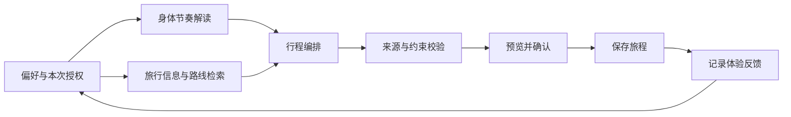

<p align="center">
  <a href="https://biotrip.eazylee.si">
    
  </a>
</p>

<p align="center">
  <strong>一个听见身体感受，也陪你看世界的 AI 旅行伙伴。</strong>
</p>

<p align="center">
  <a href="https://biotrip.eazylee.si/app"><strong>开启旅程 ↗</strong></a> &nbsp; · &nbsp;
  <a href="https://biotrip.eazylee.si/#film">观看影片 · 02:37</a> &nbsp; · &nbsp;
  <a href="https://biotrip.eazylee.si">产品官网</a> &nbsp; · &nbsp;
  <a href="README.en.md">English</a>
</p>

<p align="center">
  <a href="https://github.com/EazyLee30/biotrip-fliggy-hackathon/actions/workflows/ci.yml"></a>
  <a href="docs/verification.md"></a>
  
</p>

<br />

## 旅行计划，也应该听见你的感受

昨晚没睡好，走到下午有些累，或是想在喜欢的茶馆多坐一会儿。旅途中的状态一直在变，行程也应该留有余地。

BioTrip 将旅行偏好、当下自评和经授权的 WHOOP 记录带进规划，帮助你减少步行、增加休息、调整活动密度。看清变化，再决定采用；重要预约和已经完成的安排受到保护。

## 从感受出发，让下一步更适合你

<p align="center">
   &nbsp;
   &nbsp;
  
</p>

<p align="center"><sub>今日行程 &nbsp; / &nbsp; 身体记录 &nbsp; / &nbsp; 调整与反馈</sub></p>

| 01 · 记录感受 | 02 · 调整旅程 | 03 · 体验反馈 | 04 · 优化建议 |
| :--- | :--- | :--- | :--- |
| 告诉 BioTrip 此刻的状态 | 预览变化，确认后采用 | 记录是否轻松了一些 | 近期反馈参与下一次建议 |

这是一条持续的反馈闭环。一次疲劳只代表当下，长期偏好由你选择记住。

WHOOP 已支持恢复、睡眠、活动负荷和步数；没有设备，也能通过自评使用核心功能。**后续将支持更多可穿戴设备的数据源。**

<sub>以上为实际产品界面。WHOOP 展示本人授权的历史记录；杭州旅程与疲劳评分变化用于演示操作流程。</sub>

## 一路相伴的能力

| 能力 | 在旅途中如何帮助你 |
| :--- | :--- |
| **属于你的行程** | 根据目的地、日期与偏好安排每天的活动，支持手动编辑和版本回看。 |
| **有出处的发现** | 飞猪旅行服务、公开当地资料和高德路线各有来源，缺少依据的信息不作为已验证结果。 |
| **随时聊聊的伙伴** | 查询安排、整理清单、提出调整建议，行程变更先预览、再确认。 |
| **记住喜欢的节奏** | 管理旅程、当天与长期记忆；近期反馈参与建议，长期偏好可编辑、停用或撤销。 |
| **留下旅行片刻** | 收藏想去的地方，分享旅行手记，公开分享范围由你确认。 |

[用 2 分 37 秒，走进一次从身体感受出发的旅行 →](https://biotrip.eazylee.si/#film)

## 为真实旅行而构建

**React 19 · TypeScript · Next.js / vinext · Cloudflare Workers · D1 · Workflows**

阿里云百炼负责规划与随行对话，FlyAI 提供旅行服务检索，高德核验路线，WHOOP 提供可选的身体数据。用户授权、来源核验、日程约束和版本校验由服务端执行。

<details>
<summary><strong>查看系统分工与数据边界</strong></summary>



- 身体原始记录仅进入专用解读环节，旅行检索使用公共旅行条件。
- 库存、当地资料、高德出行和编排各有独立职责与权限。
- 无依据的价格、路线数字和链接不会补写为事实；没有匹配结果时如实说明。
- 助手提出的行程变更需要确认，服务端再次核对归属、版本与固定安排。

详见 [系统设计](docs/architecture.md)。

</details>

## 本地运行

需要 **Node.js 22+** 和 **pnpm 10**。真实规划需配置百炼与 FlyAI；邮箱登录需配置邮件服务。WHOOP 为可选连接。

```bash
pnpm install --frozen-lockfile
cp .env.example .dev.vars
# 按接入文档填写本地环境变量
pnpm exec wrangler d1 migrations apply biotrip-users --local
pnpm dev:vinext
```

打开 [localhost:3001](http://localhost:3001)，从 `/app` 进入应用。独立部署时，请将 `wrangler.jsonc` 中的域名、数据库及服务标识替换为自己的配置。

| 文档 | 内容 |
| :--- | :--- |
| [服务接入](docs/platform-access-checklist.md) | 百炼、FlyAI、WHOOP 与账号配置 |
| [部署指南](docs/cloudflare-deployment.md) | Worker、D1 迁移与生产环境 |
| [百炼配置](docs/bailian-agent-setup.md) | 规划 Provider、Agent 与权限边界 |
| [高德接入](docs/amap-mobility-setup.md) | 独立出行顾问与真实路线依据 |
| [邮箱登录](docs/email-auth-setup.md) | 发信域名与登录邮件 |
| [验证说明](docs/verification.md) | 检查命令、覆盖范围与已知限制 |

<details>
<summary><strong>项目结构与验证命令</strong></summary>

```text
src/app/             产品页面、API 与移动端交互
src/lib/             规划、助手、反馈与来源核验
src/workers/         Worker 入口与后台 Workflow
migrations/          D1 数据迁移
public/              应用必需素材、官网与产品影片
bailian/             FlyAI Skill 与配置参考
docs/                运行文档、系统设计与素材许可
```

```bash
pnpm exec tsc --noEmit
pnpm test
pnpm lint
pnpm run build:vinext
```

截至 2026-10-23，486 项测试及 CI 检查通过，官网发布的 35 项线上检查通过。浏览器移动端仿真与实体手机验收分别记录，详见验证说明。

</details>

## 数据与素材

WHOOP 授权信息按账户加密保存，公开分享排除健康数据与个人记忆。生产密钥保存在服务端；本地凭据、数据库、设计草稿、开发截图和视频制作工程不进入源码仓库。

[隐私说明](https://biotrip.eazylee.si/privacy) · [图片与字体来源](https://biotrip.eazylee.si/credits) · [素材许可档案](docs/assets/README.md)

本仓库公开源代码，未声明统一开源许可证。第三方素材与 Skill 保留各自许可。

<br />

<p align="center">
  <br />
  <sub>独立构建 · <a href="https://github.com/EazyLee30">Eazy Lee</a></sub><br /><br />
  <strong>世界很大，按你的节奏走。</strong><br />
  <a href="https://biotrip.eazylee.si/app">与 BioTrip 一起出发 ↗</a>
</p>
